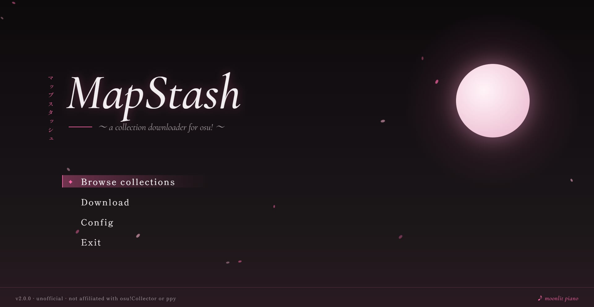
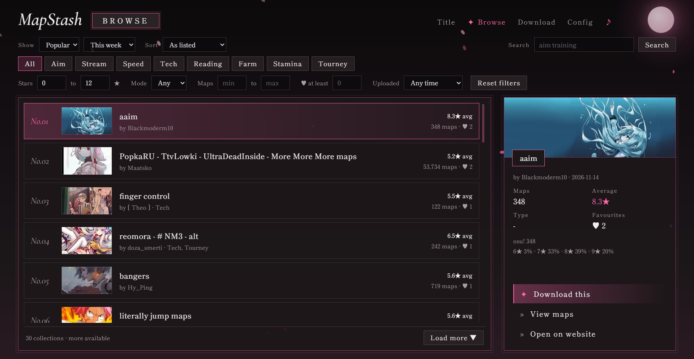
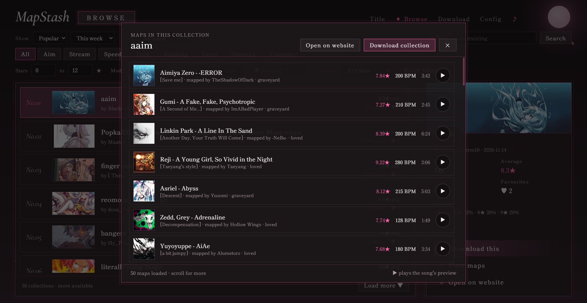
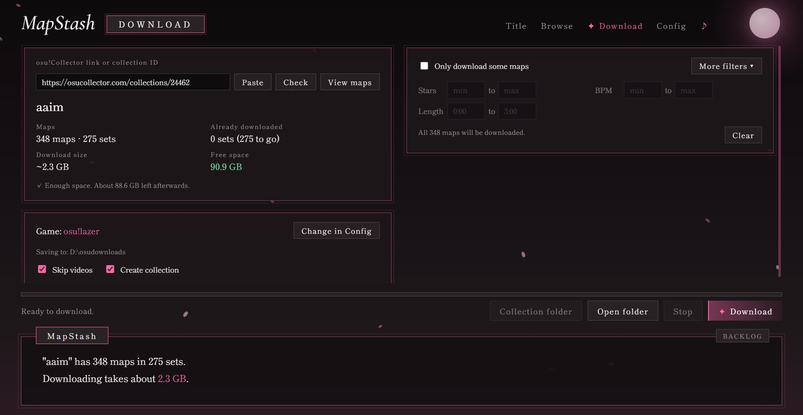

<p align="center"></p>

# MapStash

**A free collection downloader for osu!**, dressed up like a 2000s visual novel. Browse [osu!Collector](https://osucollector.com) collections right in the app (or paste a link), and MapStash downloads every map from free beatmap mirrors, then sets the collection up for osu!lazer or osu!stable.

> **Unofficial.** MapStash is not affiliated with osu!Collector or ppy. If you enjoy osu!Collector, please consider supporting its creator. They run the site that makes sharing collections possible.

## Screenshots

<p align="center">
  
</p>

| Browse collections | Maps and song previews |
| --- | --- |
|  |  |

<p align="center">
  
</p>

## Features

- **Browse collections** inside the app: popular (today / week / month / all time), recent, and search
- **Filter collections** by category (Aim, Stream, Speed, Tech, Reading, Farm, Stamina, Tourney), star rating, game mode, number of maps, favourites and upload date
- **Cover art and song previews**: see every map in a collection with its cover, stars, BPM and length, and press ▶ to hear it
- **Download only some maps** from a collection, filtered by stars, BPM, length, AR, CS, OD, HP, game mode and ranked status (for example only ranked 6-7★ maps under 3 minutes)
- Works with **osu!lazer** and **osu!stable**
- Shows **download size and free disk space** before you start, and asks what to do if it won't fit
- Live progress: maps done, GB downloaded, speed and time left
- **Pause and resume**: maps you already have are skipped
- Tries several free mirrors per map (catboy.best, nerinyan, osu.direct, sayobot)
- Builds the in-game collection for you (backs up your existing `collection.db` first)
- A visual novel interface: title screen, message box with typewriter text, backlog, choice menus, falling petals (you can turn the effects off in Config)
- **Calm background piano**: an original piece MapStash plays live, so it never repeats the same way twice. Or point it at a folder of your own music. Mute it anytime with ♪

## Download

Grab **MapStash.exe** from the [Releases](../../releases) page and run it.

- Windows SmartScreen may warn about an unknown app the first time, because the exe isn't code-signed. Click **More info → Run anyway**.
- MapStash uses Microsoft Edge WebView2, which comes with Windows 10 and 11. If it's missing, MapStash tells you where to get it.

### Run from source

Needs Python 3.8+.

```
pip install -r requirements.txt
python mapstash.pyw
```

## How to use

1. Choose **Browse collections** on the title screen, pick a collection and click **Download this**.
   You can also paste a link from osucollector.com on the **Download** screen.
2. MapStash checks the collection and shows the download size and your free space.
3. Optional: tick **Only download some maps** and set stars, BPM or length. **More filters** adds AR, CS, OD, HP, game mode and ranked status.
4. Click **Download**. Pick osu!lazer or osu!stable and your folders in **Config**.

### osu!lazer

lazer has no Songs folder, so there's one extra step:

1. Click **Open folder**, select all the `.osz` files (Ctrl+A) and drag them onto the lazer window.
2. After the import finishes, go to **Settings → Maintenance → import from stable**, choose the folder that **Collection folder** opens, and tick only **Collections**.

### osu!stable

Close osu! before downloading so the collection can be saved. When you open osu! again, it imports the new maps automatically.

## Project layout

| File | What it does |
| --- | --- |
| `mapstash.pyw` | Starts the app window |
| `bridge.py` | The functions the interface can call (browse, check, download…) |
| `core.py` | osu!Collector API, mirror downloads, size estimates, filters, `collection.db` |
| `ui/` | The interface: `index.html`, `style.css`, `app.js`, and `music.js` (the background piano) |
| `assets/` | The app icon (`icon.ico` for the exe, `icon.png`) |

## Building the exe yourself

Double-click `build_exe.bat`, or run:

```
pip install pyinstaller -r requirements.txt
pyinstaller --onefile --windowed --name MapStash --icon assets/icon.ico --add-data "ui;ui" --add-data "assets;assets" mapstash.pyw
```

The exe ends up in `dist/`.

## Notes

- Large collections can be tens of GB. Use **Skip videos** to save space.
- Mirrors are run by third parties and can be slow, rate-limited or down. Failed maps are listed in `failed_<id>.txt` and retried the next time you press Download.
- Please don't set parallel downloads too high. Be nice to the free mirrors.

## License

[MIT](LICENSE)
